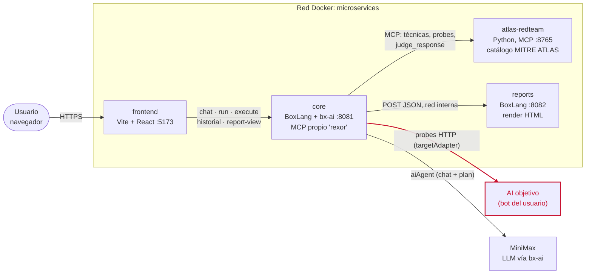

# Break Me — ANIA x Ortus Hackathon (Reto 05)

AI red-teaming platform: usa IA pa hacer pentesting/red-teaming automático a
otra IA. Arquitectura de microservicios — cada equipo trabaja aislado en su
propia carpeta bajo `services/`, sin tocar archivos compartidos.

Ver [CLAUDE.md](./CLAUDE.md) pa contexto completo del reto, decisiones y
estado del proyecto.

## Arquitectura



- El navegador **solo habla con `core`**. `core` arma el plan con un
  `aiAgent` (MiniMax) conectado por MCP a `atlas-redteam` y a su propio MCP
  server (`list_target_types`, `create_test_plan`, `run_probes`), ataca al
  bot del usuario por HTTP, archiva chats y reportes, y le pide el HTML a
  `reports` por la red interna.
- Línea roja = tráfico de ataque hacia la IA objetivo; la evaluación de cada
  respuesta (`judge_response`) es determinística, sin LLM.

## Servicios

| Servicio | Stack | Qué hace |
|---|---|---|
| [`atlas-redteam`](./services/atlas-redteam) | Python, MCP | Catálogo MITRE ATLAS + toolkit de probes/attack corpus, expuesto como servidor MCP. Fuente de verdad de "qué ataques existen" y "cómo evaluar una respuesta". |
| [`core`](./services/core) | BoxLang + bx-ai (MiniMax) | Orquestador: dado el tipo de IA a testear, consulta el MCP de `atlas-redteam` pa elegir técnicas/probes (`/api/run.bxm`), ejecuta esos probes contra la IA real del usuario vía un adapter HTTP configurable (`/api/execute.bxm`), y expone todo eso como MCP propio + un asistente de chat (`/api/chat.bxm`). Guarda historial de chats y reportes. Es el componente que cumple el requisito BoxLang + BoxLang AI del reto. |
| [`frontend`](./services/frontend) | Vite + React | UI: chat AI-driven (por defecto) o formulario clásico paso a paso, historial de chats/reportes, y visor de reportes (renderizados server-side por `core`). |
| [`reports`](./services/reports) | BoxLang (MiniServer) | Convierte el JSON de hallazgos (de `core` o del harness Python) en un reporte HTML con mitigaciones ATLAS. |
| [`_template-python`](./services/_template-python) | Python/FastAPI | Plantilla base pa nuevos servicios Python. |
| [`_template-boxlang`](./services/_template-boxlang) | BoxLang (MiniServer) | Plantilla base pa el servicio BoxLang/BoxLang AI (requisito del reto). |

## Reglas de convivencia (evitar conflictos de merge)

Cada microservicio es auto-contenido: su propio `Dockerfile`, `docker-compose.yml`
y `.env` (no se commitea). Nadie edita un compose/Dockerfile compartido.

### Crear un servicio nuevo

1. Copiá la plantilla que corresponda:
   - `services/_template-python` — Python (FastAPI).
   - `services/_template-boxlang` — BoxLang.
2. Renombrá la copia a `services/<tu-servicio>`.
3. Reemplazá `change_me` por el nombre real del servicio en `docker-compose.yml`
   (y en `app/main.py` si es Python).
4. En `docker-compose.yml`, actualizá `build:` y `env_file:` pa que apunten
   a `./services/<tu-servicio>/...` (no al nombre de la plantilla) — el
   script de abajo levanta todos los servicios en un solo proyecto desde la
   raíz del repo, así que las rutas son relativas a la raíz, no a tu carpeta.
5. Copiá `.env.example` a `.env` y ajustá valores.
6. Elegí un puerto de host libre en tu `docker-compose.yml`.

### Levantar todo

```bash
./scripts/compose.sh up --build
```

El script descubre automáticamente todos los `services/*/docker-compose.yml`
(menos las plantillas `_template-*`) y los levanta juntos en la red compartida
`microservices`. Agregar o quitar un servicio no requiere tocar ningún archivo
central.
